<picture>
  <source media="(prefers-color-scheme: dark)" srcset="assets/banner-dark.svg">
  
</picture>

### 🧰 开源项目 · Projects

<a href="https://github.com/BTCUP99/postglow">
  <picture>
    <source media="(prefers-color-scheme: dark)" srcset="assets/panel-postglow-dark.svg">
    
  </picture>
</a>

<a href="https://github.com/BTCUP99/jax-stopwatch">
  <picture>
    <source media="(prefers-color-scheme: dark)" srcset="assets/panel-jax-dark.svg">
    
  </picture>
</a>

| 项目 | 一句话 | 安装 |
|---|---|---|
| [**Postglow · 账号复盘**](https://github.com/BTCUP99/postglow) | 每小时读一次你的 X 帖子，在本地告诉你哪些帖子被看、什么时候发更好、粉丝从哪来。不用登录、不用 API Key。 | [下载 DMG](https://github.com/BTCUP99/postglow/releases/latest) 或一行命令 |
| [**jax-stopwatch**](https://github.com/BTCUP99/jax-stopwatch) | 把 M5Stack StopWatch 变成 Codex / Webhook Agent 的随身语音入口：按住说话，Mac 帮你办。 | 照着 README 让你的 Agent 帮你装 |

更多实用工具在路上 · More tools on the way. 欢迎 Star、Issue 和 PR。
