<picture>
  <source media="(prefers-color-scheme: dark)" srcset="assets/banner-dark.svg">
  
</picture>

<a href="https://github.com/BTCUP99/jax-stopwatch">
  <picture>
    <source media="(prefers-color-scheme: dark)" srcset="assets/panel-dark.svg">
    
  </picture>
</a>

### 💡 做 Jax 时的几点体会 · Notes from building Jax

- **最快的 AI 入口不一定是聊天框。** 抬手、按住、说一句，比掏手机、开 App、打字都快。Agent 能力越强，入口越应该轻。 The fastest way to an agent isn't a chat box — it's a button you can press without looking.
- **本地优先，只把文字交出去。** 语音在 Mac 上用 MLX Whisper 识别，录音不出门；云端只拿到你确认要交给它的那句话。 Keep the audio local; send the agent only the words.
- **安全要设计进去，而不是事后补。** 凭据只经 USB 写入，设备只连出不监听，公网只开一个带密钥的入口，提醒内容永远不会被当成指令。 Secrets over the cable only, no listening ports, one keyed door to the internet.
- **文档也是产品。** 把安装步骤和形象规范写到 Agent 能照做的程度，用户只需要一句话，剩下的交给他的 Agent——连画新形象都可以。 Write docs an agent can follow, and setup becomes one sentence.

更多实用工具在路上 · More tools on the way. 欢迎 Star、Issue 和 PR。
