<picture>
  <source media="(prefers-color-scheme: dark)" srcset="assets/banner-dark.svg">
  
</picture>

### 👋 你好 / Hi

我喜欢做**解决具体小麻烦的工具**：桌面上的录音、记账、闹钟，命令行里的待办，还有会说话的硬件小伙伴。做完觉得好用，就开源出来。

I build small tools that fix everyday annoyances — desktop utilities, Android apps, CLIs and a bit of hardware — and open-source the ones that turn out useful.

---

### ⭐ 主打项目 · Featured

<table>
  <tr>
    <td width="200" align="center"></td>
    <td>
      <h3><a href="https://github.com/BTCUP99/jax-stopwatch">jax-stopwatch</a></h3>
      
把 M5Stack StopWatch 圆屏手表变成随身 AI 入口：按住说话，Mac 本地识别后交给 Codex 或 Webhook Agent，结果播回手表。支持 Wi-Fi / 手机热点、X 提醒、可换形象。

      
<i>Push-to-talk from a watch to Codex and webhook agents through your Mac — local Whisper, works anywhere, swappable avatars.</i>

      
      
      
    </td>
  </tr>
</table>

### 🧰 小工具 · Tools

| 项目 | 做什么 | 技术 |
|---|---|---|
| 🎙️ [windows-recorder-v2](https://github.com/BTCUP99/windows-recorder-v2) | Windows 系统声音 + 麦克风录音，WAV/MP3 输出，明暗主题 · *System audio & mic recorder* |  |
| 💰 [finance-accountant](https://github.com/BTCUP99/finance-accountant) | Windows 与 Android 双平台记账，收入支出分类记录 · *Cross-platform bookkeeping* |  |
| ⏰ [cute-alarm-android](https://github.com/BTCUP99/cute-alarm-android) | 可爱的 Android 闹钟，重复模式、Material 3 界面 · *A cute alarm clock* |  |
| ✅ [todo-cli](https://github.com/BTCUP99/todo-cli) | 命令行待办：添加、列出、完成 · *Todo list in the terminal* |  |
| 💾 [USBWatcher](https://github.com/BTCUP99/USBWatcher) | U 盘占用检查，找出占用 U 盘的程序 · *Find what keeps a USB drive busy* |  |

### 🛠️ 常用技术 · Toolbox

---

更多工具在路上 · More tools on the way. 欢迎 Star、Issue 和 PR。
